  

  

 

<table>
<tr>
<td valign="top" width="50%">

### ~/stack $ pacman -Qe

**languages** 

**ml & data** 
 

**backend & mlops** 

**data & infra** 
 

also: NLP, neural networks, model evaluation, feature engineering, experiment tracking, monitoring, data modeling, ETL, DAX

</td>
<td valign="top" width="50%">

### ~/projects $ paru -Qm

**[DodocLens](https://github.com/moonlitrevery/dodoclens)** 
document intelligence with local AI (OCR + semantic search) for PDFs and images.

**[Churn pipeline](https://github.com/moonlitrevery/mlechurn)** 
production-ready ML system for churn prediction with monitoring, explainability, and deployment.

**CRNN image challenge engine** *(private)* 
developed a CRNN model that could solve image challenges.

</td>
</tr>
</table>

### ~/stats $ fastfetch

  
  

 

### ~/connect $ ping

